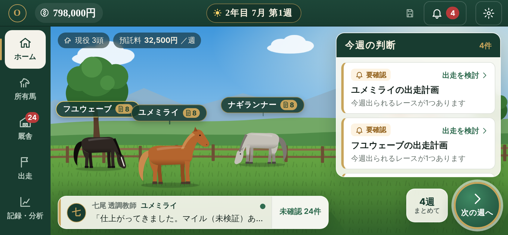
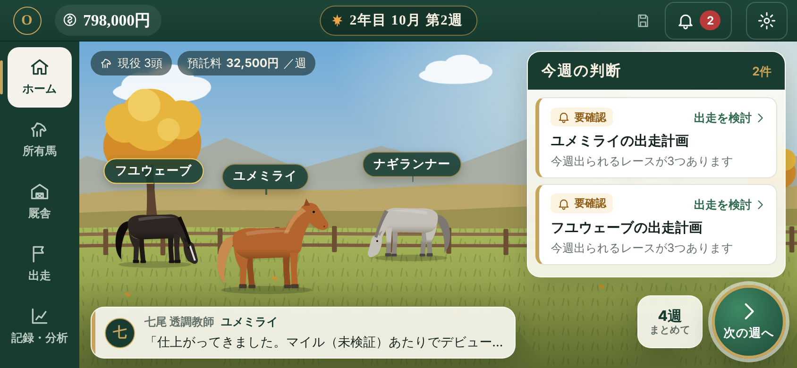
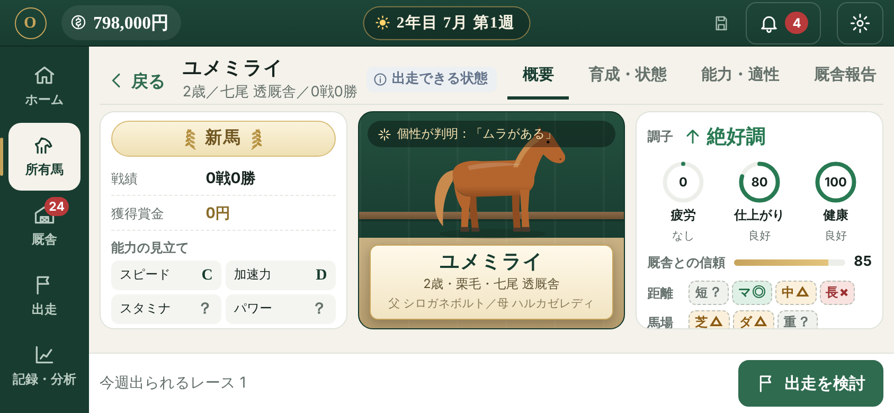
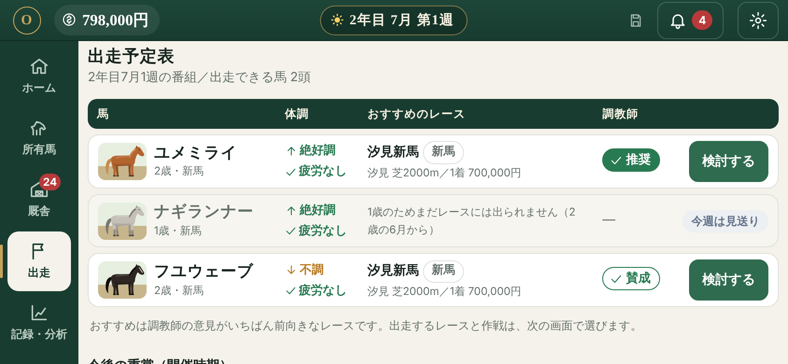
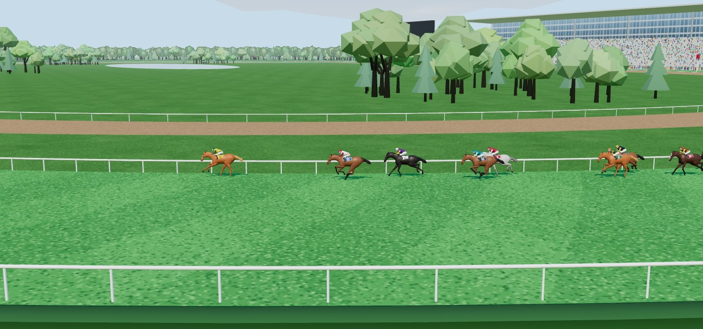
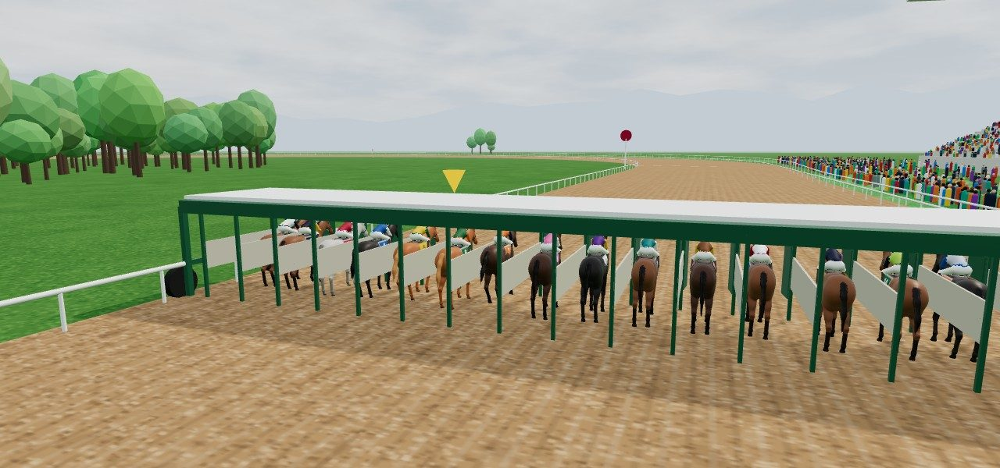
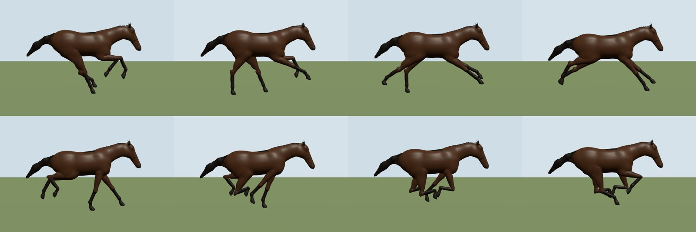
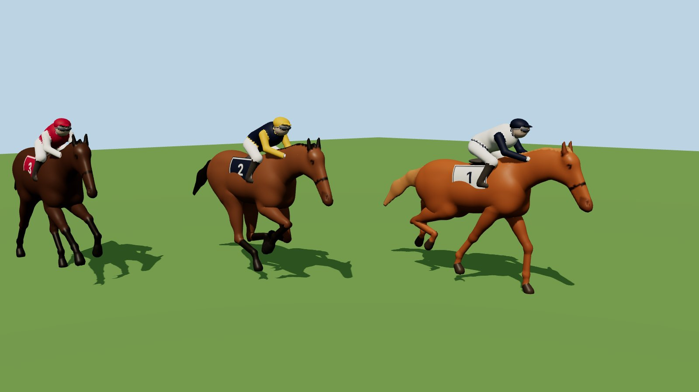

# オンライン競走馬オーナーズ（仮）

競走馬を育成し、レースに出走させて賞金を積み上げるブラウザゲームです。
製品版の主目的はプレイヤー同士のオンライン対戦ですが、開発は **オフライン先行** で進めています。
オフライン版（ひとりで遊ぶ）は、育成・レース・経済バランス・3D演出を検証するための開発用モードです。

## 開発段階と現在地

開発指示書 v1.4（馬主システム・厩舎運営・才能の見極め・情報解明）に沿って、オフライン版を「馬主モード」に作り替えました。
プレイヤーは調教師ではなく馬主です。馬を厩舎に預けて育成方針を伝え、調教師の報告と自分のレース分析から、まだ見えない才能を見極めます。

| 段階（指示書18章） | 内容 | 状態 |
|---|---|---|
| 1. 馬主の基本機能 | 所有馬管理・厩舎への預託・育成方針・調教師からの報告 | ✅ |
| 2. 情報解明の基礎 | 真の能力値の非公開管理・抽象コメント・解明度・評価ランクの開示・能力成長との分離 | ✅ |
| 3. レースと分析 | CPU馬とのレース・着順/タイム/賞金・ラップと戦績の分析・分析結果の情報解明への反映 | ✅ |
| 4. 数値開示と調教師の個性 | 数値の段階的な公開・調教師の経験と得意分野・評価誤差・厩舎選び | ✅ |
| 5. 育成・経営の拡張 | 資金管理・預託料・厩舎との関係・売却・引退 | ✅（血統・配合は未実装。データ欄のみ用意） |
| 6. オンライン化 | サーバー側データ管理・プレイヤー間の競争・不正防止 | 🧪 旧システムの試作のまま（下記） |

## 構成

```
shared/   ゲームのルールと計算（画面にもサーバーにも依存しない。依存ライブラリなし）
  owner/        馬主モード（指示書 v1.4）
    config.ts     バランス設定ファイル（開示条件・ランク境界・距離補正・観測精度）
    model.ts      馬のデータ構造（truth / state / knowledge / record を分離）
    knowledge.ts  情報解明（証拠 → 推定 → 抽象表現・ランク・数値の開示、評価修正の記録）
    trainers.ts   調教師（調教の腕と見る目を別々に持つ。数値は非公開）
    stable.ts     厩舎の1週間（方針 → 調教計画 → 状態・成長 → 観察と報告）
    growth.ts     能力の成長（真の値だけを変える）
    sim.ts        レース計算（10Hz・加速・スタミナ・コーナー・進路・騎手AI。シード付きで再現可能）
    racecard.ts   週ごとの番組・重賞・CPU馬
    analysis.ts   レース記録から読み取れること（何がどれだけ分かるか）
    view.ts       馬主に見せてよい情報だけを取り出す（真の値は含めない）
    game.ts       ゲーム進行（購入・方針・週送り・出走・分析・売却・引退）
    lab.ts        統計検証（仮の馬で数百回走らせる）
  race.ts ほか  旧システム（オンライン試作が使用）
client/   React + Vite + three.js
  src/owner/    馬主モードの画面
  src/offline/  セーブ・ロード（旧形式からの引き継ぎを含む）と状態管理
  src/three/    3D競馬場とレース再生（表示のみ。計算はしない）
    model/        馬・騎手のモデル（形・骨格・走り）。外部のモデルファイルは使わず、コードで生成
    course/       競馬場（走路・柵・スタンド・発馬機・空）
  src/screens/  オンライン試作の画面
server/   オンライン対戦の試作（Node.js・PostgreSQL・Colyseus。旧システム）
```

計算・馬の内部データ・情報解明・画面表示は分けてあります。画面は `toHorseView()` で作った「見え方」だけを使い、真の能力値には触れません。

## 画面（UI v3「牧場」：スマートフォン横向き1画面）

v2.0 の1画面設計を土台に、競馬シミュレーションゲームらしい「景色の上に情報を重ねる」画面へ作り替えました。
参考にした画面より情報を絞り、「次に何をするか」が一目で分かることを優先しています。

- **ホーム（牧場）**：季節で変わる牧場の景色（春・夏・秋・冬）に所有馬が並び、名札（未確認の報告数つき）から馬の詳細へ。右に「今週の判断」カード、下に調教師のひとこと（最新の報告）、右下に大きな「次の週へ」と「4週まとめて」。上部バーは日付を中央に（季節のアイコンつき）
- **所有馬**：馬の絵（毛色つき）を添えたカード
- **馬の詳細・概要（名鑑）**：左にクラス・戦績・獲得賞金・能力の見立て、中央に馬の姿と名前の銘板、右に調子（矢印＋言葉）・疲労／仕上がり／健康の円グラフ・厩舎との信頼・適性（◎○△×？、未検証は点線）
- **出走予定表**：出走タブの最初に全馬の一覧。体調・おすすめのレース（調教師の意見がいちばん前向きなもの）・調教師の意見・「検討する」。縦向きではカード表示
- **文字入力**：入力欄はすべて16px以上（iOS で入力欄に触れると画面が拡大されたままになる不具合の対策）。キーボードを閉じた後に画面が上にずれたまま残る場合も元に戻す（`client/src/keyboard.ts`）
- 馬の絵と景色は本作独自の図形です。毛色は馬ごとに見た目だけで決まり、ゲームの計算には使いません

以下は v2.0 で決めた全体の構成です（v3 でも同じ）。


スマートフォンの横向きを基本に、主要な画面はページ全体をスクロールせずに1画面で操作できます。縦向きでも遊べます（回転の強制はしません）。

| 向き | 構成 |
|---|---|
| 横向き | 上：年月・所持金・保存状態・お知らせ・設定／左：主要メニュー（ホーム・所有馬・厩舎・出走・記録・分析）／中央：画面本体（中だけスクロール）／下：次の主要操作。詳細は右から出るパネルで開く |
| 縦向き | 上：同じステータス／下：主要メニュー。補助情報は切り替えや下から出るシートへ |

- **ホーム（オーナーズ・デスク）**：今週の判断（緊急・要確認・通常の3段階、色＋アイコン＋文字）、注目馬、厩舎報告、預託料、週送り。週送りは二重実行を防ぎ、結果（資金の変化・判明したこと・育成の結果）をまとめて表示
- **所有馬**：カード一覧（体調・次の予定・未確認の報告・能力調査の進捗）と詳細6タブ（概要・育成・状態・能力・適性・厩舎報告・戦績・分析・所有・経営）。能力は段階（見立て・ランク・数値）と推定の確かさを分けて表示し、新たに判明した項目は控えめに光らせる
- **厩舎**：報告を要約→詳細で表示。報告から方針の変更・出走計画・能力の見立て・前走の分析・調教師への回答（出走を検討／休ませる／方針どおり）へ直接進める。調教師は公開情報と「見立てが修正された回数」で比べる
- **出走**：候補レース・調教師の意見・この条件の見立て（未検証／判断材料不足）・リスクと期待・作戦（説明つき）を1画面で。確定前に確認ダイアログ
- **レース観戦**：経営画面から独立した全画面モード。残り距離・上位と自分の馬・カメラ・再生速度（等速／2倍／4倍）・順位表。最終コーナー・直線・ゴール前の競り合い・ゴールで演出。回転してもレースは止まらず、やり直しにもならない。結果は着順・タイム・着差・賞金・要約・調教師の振り返り・分かったこと・次の行動
- **記録・分析**：戦績カード、レース分析（総評・レース展開・走り・詳細データ。下記「レース分析の考え方」）、評価の推移、収支。バランス調整用の「検証」は設定の「開発者向け機能」をオンにしたときだけ表示
- **設定**：演出（標準／簡略）、効果音（初期値オフ）、3D描画の品質、再生速度、セーブデータ

画面の部品は `client/src/owner/` にあります（AppShell・ui.tsx の共通部品・feedback.tsx の通知と確認ダイアログ・シート）。画面に渡すデータは `vm.ts`（表示用データ）で作り、セーブの馬データ（真の能力など）は渡しません。

## 遊び方（オフライン：サーバー不要）

```bash
npm install
npm run dev:client      # http://localhost:5173 を開いて「ひとりで遊ぶ」
```

1. 馬主名を決め、1歳馬3頭から最初の1頭を選んで厩舎に預ける。能力は見えず、手がかりは下見の印象だけ
2. 育成方針（成長重視・早期デビュー重視・距離適性の調査など9種）を伝え、週を進める。調教の中身は調教師が馬の状態を見て決め、毎週報告が届く
3. 2歳の6月からデビューできる。今週の番組から選び、調教師の意見（推奨・賛成・慎重・反対）を聞いて、脚質・ペース・仕掛けを指示する
4. レース後は「分析」でラップ・通過順・上がり・不利を見直し、評価に反映する。短距離戦ではスタミナは分からない、競り合いがなければ根性は分からない、など得られる情報はレースの中身次第
5. 賞金で馬を買い足し、転厩・売却・引退も判断する。預託料は毎週かかる

### 情報解明のしくみ

- 各馬は真の能力（スピード・加速力・スタミナ・パワー・根性・賢さ）と適性・個性・成長型を持つが、画面には出ない
- 厩舎の観察・調教時計・調教師のレース評・馬主の分析が「証拠」になる。証拠は 真の値＋情報源の偏り＋ばらつき として生まれ、同じ調教師の偏りは何度報告を重ねても消えない。別の情報源（実戦の分析）で修正される
- 証拠がそろった能力から、言葉（抽象表現）→ 評価ランク（S〜E）→ 数値（0〜100）の順に開示。ランクには厩舎の観察以上の証拠、数値には2レース以上の実戦が必要。年齢だけでは何も開示されない
- 能力ごと・適性ごとに独立して解明される。走ったことのない距離・馬場は「未検証」
- 能力の成長（真の値の変化）と、推定の修正（「下方修正：推定の修正であり、能力そのものの変化ではありません」）は別々に記録する
- 開示条件・ランク境界・距離補正などは `shared/src/owner/config.ts` で変更できる

| クラス | 出走条件 | 1着賞金 | 相手の能力 |
|---|---|---|---|
| 新馬 | 未出走（2歳6月〜） | 700,000円 | 33〜47 |
| 未勝利 | 未勝利 | 550,000円 | 37〜50 |
| 1勝クラス | 1勝 | 900,000円 | 45〜57 |
| 2勝クラス | 2勝 | 1,300,000円 | 52〜64 |
| オープン | 3勝以上 | 2,200,000円 | 58〜71 |
| 重賞（年7レース） | 2勝以上など | 4,500,000円 | 64〜79 |

競馬場は2つ（翠ヶ丘：右回り・坂あり／汐見：左回り・小回り）、芝とダート、1000〜3000m。

**セーブ**：操作のたびにブラウザ（localStorage）へ自動保存。ファイルへの書き出し・読み込みもできる。旧形式（バージョン1）のセーブは読み込み時に新形式へ変換し、旧形式で見えていた能力は判明済みとして引き継ぐ（変換前のデータも退避して残す）。
セーブが読み込めないときも**データは消さず**、「直前に正常に読み込めた状態に戻す」「読み込めなかったデータをファイルに書き出す」を選べる。新しく始め直すのは確認したうえでだけ。

## Webアプリとして使う（PWA）

公開版：<https://mikado420.github.io/Horse-Racing/>

- **ホーム画面に追加**すると、アプリのように全画面で起動できる（設定 → アプリに OS ごとの手順。Android/PC の Chrome などでは追加ボタンが出る）。表示や手順はブラウザ・OS によって異なり、追加できない環境ではそのままブラウザで遊べる
- **オフライン起動**：一度開くと、アプリ本体（HTML・ハッシュ付きの JS/CSS・アイコン）を端末に保存し、通信がなくても「ひとりで遊ぶ」を起動できる。ログイン・所持金・レース結果などの API とオンライン対戦の通信（WebSocket）は**キャッシュしない**
- **自動更新**：起動時・画面に戻ったとき（前回から10分以上）・45分ごとに新しいバージョンを確認し、裏で取得する。切り替えは安全なときだけ
  - 切り替えない：レース観戦中・週送りなどの処理中・確認ダイアログ表示中・入力途中（名前入力・購入・最初の1頭選び）・オンライン対戦中
  - 切り替える：上部の「更新を適用」を押したとき／画面が裏に回ったとき／起動直後でまだ操作していないとき。押したときに観戦中なら、終わってから切り替える
  - 複数のタブで開いている場合：一方で切り替えると、他のタブも作業中でなければ読み込み直す（作業中なら終わってから）。セーブはタブ間で同期する
  - 更新の確認に失敗しても、今のバージョンのまま遊べる。設定 → アプリにバージョン・状態・最終確認時刻を表示
- **セーブデータは更新で消えない**（ブラウザの localStorage に保存し、アプリ本体のキャッシュとは別）。セーブの形式が変わるときは、変換前のデータを控えてから変換し、失敗したら元のまま残す
- 開発中（`npm run dev:client`）は Service Worker を使わない
- 実装：`vite-plugin-pwa`（Workbox）で Service Worker を生成し、登録と切り替えは `client/src/pwa/` で制御（`policy.ts` が判断、`update.ts` が実行）。マニフェストは `client/public/manifest.webmanifest`

## 公開の流れ

```
作業ブランチに push ─→ CI（.github/workflows/ci.yml）
                         テスト（shared・client・server。PostgreSQL つき）→ 型チェック → 本番と同じ設定でビルド → 成果物の確認
                         ※公開はしない。結果とビルド成果物は ci-preview ブランチに残る（検証用）
main に反映 ─────────→ 公開（.github/workflows/pages.yml）
                         同じ確認がすべて通ったときだけ GitHub Pages に公開 → 公開後の確認
                         （配信中の version.json が今回のコミットに切り替わったこと、sw.js・マニフェスト・アイコンが正しい形式で取得できること）
```

- `scripts/check-dist.mjs`：ビルド成果物に Service Worker・マニフェスト（名前・色・アイコン3種）・version.json がそろい、HTML が参照する JS/CSS がハッシュ付きで事前取得の対象になっているか、API が含まれていないかを確認
- バージョンはコミットの短いハッシュ。画面（設定 → アプリ）と `version.json` で確認できる
- **元に戻す（ロールバック）**
  1. すぐ戻す：Actions の「GitHub Pages」で正常だった過去の実行を「Re-run all jobs」、または「Run workflow」で `ref` に戻したいコミット・タグを指定
  2. 恒久的に戻す：`git revert <コミット>` を main に push
  - どちらも利用者の端末には「新しいバージョン」として届き、安全なときに切り替わる。セーブデータは変わらない
- GitHub Pages ではレスポンスヘッダーを設定できない（どのファイルも10分キャッシュ）。そのため Service Worker は `updateViaCache: "none"` で登録し、更新確認のたびに sw.js をサーバーへ問い合わせる。自前のサーバー（`server/`）で配信する場合は、`assets/` を1年・immutable、`sw.js`・HTML・マニフェスト・`version.json` を `no-cache` で返す（`cacheControlFor()`）

## テスト

```bash
npm run test:offline   # shared と client（オフライン版）。サーバー・DB不要
npm test               # 上記＋server（PostgreSQLが必要）
```

| 対象 | 件数 | 内容 |
|---|---|---|
| shared（レース分析） | 20 | 同じ記録からは同じ報告・コメント／コメントで触れた出来事がすべて記録で確かめられる／勝ったレースで敗因を推定しない・根拠がなければ「特定できない」／推定には根拠の観察がある／言い回しを変えても内容は同じ／内部のエネルギー残量で報告が変わらない／記録にない不利を述べない／データ不足でも数値や断定を作らない／報告に内部の数値が含まれない／ラップ合計＝勝ち時計（200mで割り切れない距離も）・上がり3F・通過順・着順の検算／個性の兆候は記録だけで決まる／週報で個性のない馬に兆候を出さない／週報の観察は「印象」 |
| shared（馬主モード） | 27 | 指示書17章の要件：年齢だけでは開示されない／能力ごとに独立／未検証の扱い／調教師ごとの評価精度と誤り／分析による修正／情報解明で真の値が変わらない／成長と評価修正の区別／再現性／設定ファイルでの調整／非公開データを含まない見え方／能力差・距離適性・馬場適性・個性・作戦が結果に反映される統計検証／自動プレイ3年分／UI再設計の前後でレース計算が完全に一致すること |
| shared（旧システム） | 22 | オンライン試作が使うレース計算・育成 |
| client | 28 | 旧バージョンの調教師コメントを読み込み時に作り直す（形式は変えない・何度実行しても同じ）、セーブ・ロード、破損時にデータを消さず直前の正常な状態に戻せること、旧形式からの引き継ぎ（失敗しても元データを残す）、画面に渡す表示用データに非公開情報が含まれないこと、報告の重要度、重要事項の並び、更新の確認・切り替えの判断（観戦中・処理中・入力中は切り替えない、複数タブ）、出走予定表のおすすめ・今のクラス・毛色、3D：歩幅と完歩数・着地中の蹄が滑らないこと・交叉襲歩の足順・コース座標がレース計算と一致すること・坂・モデルの形データ |
| server | 25 | 認証・API・DB保存・ロビー（実 PostgreSQL）、CORS、静的ファイルの Content-Type と Cache-Control |

## レース分析の考え方

ゲームの内部ではレースを精密に計算しますが、馬主に見せるのは現実の競馬で知り得る範囲の情報です（`shared/src/owner/report.ts`）。

| 種類 | 内容 | 例 |
|---|---|---|
| 記録 | 定義どおりに取れる値（ゲーム内の計測） | 着順・タイム・着差・レースラップ・上がり3F・地点ごとの通過順 |
| 観察 | 記録から確かめられる出来事 | 序盤は8番手で運んだ／残り400mから2頭をかわした／前が壁になる場面があった |
| 推定 | 観察を根拠にした「可能性」。根拠がそろわなければ出さない | 前半の速い流れを前で追いかけたぶん、最後に苦しくなった可能性がある |
| 提案 | 次走で試せる選択肢（結果は保証しない） | ペースを控えめにして、終盤の脚の残り方を比べる |

- 調教師のレース後コメントは上の4種類から組み立てます。言い回しは複数ありますが、どれも同じ意味で、何を言うかはレース記録だけで決まります。負けて根拠がないときは「明確な原因を特定できません」と答えます
- 内部の速度・エネルギー残量・詰まった秒数などは画面に出しません。エネルギー残量だけで「スタミナ切れが敗因」とは言いません（v2.0 の計算ではエネルギーが尽きた馬の34%が3着以内に入っていたため。v2.1 ではエネルギー切れ自体が出走馬の約0.6%に減り、尽きた馬の約13%が3着以内）
- レース中の個性の兆候は記録に表れた行動だけから判断します。1レースの記録で区別できるのは「行きたがる」だけです
- ペースは同じ距離帯のレースと比べて判断します（基準は `ANALYSIS_RULES`。レース1,292回の計算で決めた）
- 調べた内容と判断の理由は `docs/analysis-audit.md` にまとめています

### レースの着差（v2.1）

1着が大きく抜け出しすぎる（着差の中央値 約7馬身・3レースに1回は10馬身超）問題を、原因を調べて計算式から直しました（着差を後から縮める処理は入れていません）。着差の中央値は約1.4馬身、1-2着の差は勝ち時計の平均0.34%（英国の重賞の研究で0.32%）になり、強い馬の勝ちやすさは変更前とほぼ同じです。原因・変更した式・前後の比較・残っている課題は `docs/margins/README.md` にまとめています。

## 3D表示（競馬場と競走馬）

レース観戦の3Dは、モデルの作成も含めてすべてこのリポジトリのコードで作っています（有料・外部の3Dモデルや画像は使っていません）。レースの結果はレース計算（`shared`）が決め、3Dはその走行距離と進路を再生するだけです。

**競走馬**（`client/src/three/model/`）
- 形：サラブレッドの体格（体高約1.62m、肩関節・肘・前膝・球節・蹄、股関節・後膝・飛節など実際の関節位置）に合わせて、約60の楕円体・カプセルを距離関数でなめらかに合成し、ポリゴン化（Surface Nets）。くぼみの陰影も計算して焼き込む
- 骨格：胴・首2本・頭・尾3本・脚4本×5本の骨。各頂点は近い骨に重みを付けて動く
- 走り：交叉襲歩（左手前なら 右後→左後→右前→左前→4本とも浮く）。速度から歩幅（全力で約7m）と完歩数（毎秒約2.4回）を決め、着地中の蹄は胴に対して速度と同じだけ後ろへ動かすので、地面を滑らない。脚の関節は逆運動学で解き、前膝は前、飛節は後ろに曲がる。着地の衝撃で球節が沈み、胴は上下・前後に揺れ、首はうなずき、尾はなびく
- コーナーでは内側の脚を手前にし、遠心力で内へ傾く。最後の直線で手前を替える。坂では前後に傾く
- 騎手は前傾して鐙に立つ姿勢で、馬の揺れを脚で吸収する（胴の揺れの約7割を打ち消す）。勝負服は18通りの配色、ゼッケンに馬番
- 毛色（鹿毛・黒鹿毛・栗毛・芦毛・青鹿毛）と流星は、牧場画面の絵と同じく馬ごとに決まる
- 細かさは3段階（近い4頭だけ細かく）。形の作成（約0.7秒）は Web Worker で裏で行い、出走画面を開いた時点で準備を始める

**競馬場**（`client/src/three/course/`）
- 走路の形はレース計算と同じ座標（直線2本＋半円2つ）から作るので、描画と結果がずれない。右回りは左右を反転して描く
- 芝（刈り込みの模様）とダートの2本の走路、内外の柵、200mごとのハロン棒、ゴール板と決勝線、18頭が入る発馬機（発走で扉が開き、後で片付ける）
- 坂のある競馬場はゴール前に約2mの上り坂、コーナーは外側が少し高い（カント）
- スタンド（段々の観客席・ガラスの建物・屋根）と観客、大型ビジョン（先頭集団の中継映像を映す）、内馬場の池、遠くの山、空と雲
- 木々（東京競馬場の雰囲気）：向こう正面の外に欅の並木、内馬場の4か所に林、3〜4コーナーの内側に大木、外ラチの外に生け垣、外周をぐるりと囲む木立。どの走路の上にも木は置かない
  - 軽くする工夫：近くの木だけ低ポリゴンの立体（欅・広葉樹・針葉樹の3種、種類ごとに1回の描画）。遠くの木は十字に組んだ板に木の絵（1本4三角形、約2600本で1回の描画）。木は影を落とさない（大木だけ例外）。葉の揺れは高品質のときだけ GPU で計算
- 天候（晴・曇・雨）で空と光が変わり、雨は雨粒、道悪は走路が濃くなる
- カメラ：中継（外ラチの外のやぐらから並走、直線はスタンドから、ゴール前は真横から）／自分の馬（斜め後ろから）／全体（上空）
- 品質「軽量」では影の計算をやめ、細かさと観客・木の数を減らす

## オンライン対戦（試作・旧システム）

オンライン対戦はまだ旧システム（プレイヤーが直接調教し、能力が見える方式）のままです。馬主モードへの移行は第6段階で行います（サーバーが真の値を持ち、`toHorseView()` の形だけをクライアントへ送る想定）。


```bash
docker compose up -d                    # PostgreSQL（または手元の PostgreSQL 14 以上）
cp server/.env.example server/.env
npm run dev:server                      # http://localhost:2567（API + WebSocket）
npm run dev:client                      # 「オンライン対戦」を選ぶ
```

**オンライン版を公開するとき**（GitHub Pages 版はオフライン専用。サーバーは別に用意する必要があり、まだ公開していません）

| 設定 | 場所 | 内容 |
|---|---|---|
| `VITE_API_BASE` | クライアントのビルド時 | API の配信元（例 `https://api.example.com`）。空なら同じオリジンの `/api` |
| `VITE_SERVER_URL` | クライアントのビルド時 | WebSocket の接続先。ページが HTTPS なら `ws://` は自動で `wss://` にする |
| `CORS_ORIGINS` | サーバーの環境変数 | API を呼べる画面のオリジン（カンマ区切り）。別ドメインに画面を置くときに指定 |
| `VITE_OFFLINE_ONLY` | クライアントのビルド時 | `true` でオンライン対戦を隠す（GitHub Pages 版） |

クライアントに秘密の値（鍵・パスワード）は置かない。`VITE_` で始まる値はビルド結果に公開されるので、接続先の URL だけを指定する。

- 2〜8頭。最初の登録から30秒で締切、2頭未満なら延長、8頭で即発走
- 締切の瞬間にサーバーがDBから能力を読み直し、オフライン版と同じ `resolveRace` で着順・賞金を決めて1トランザクションで保存してから全員に配信。クライアントの値は使わない
- 同じレースの二重精算はレースIDの主キー制約で防止。通信が切れても判定と賞金付与は変わらず、90秒以内なら再接続して観戦に戻れる
- 入力検証、レート制限、所有者チェック、残高チェック（行ロック）

## 動作確認の状況

**✅ 確認済み**
- GitHub Actions 上で `npm install`・全テスト（shared 49・client 25・server 25、実 PostgreSQL）・全ワークスペースの型チェック・`vite build`・成果物の確認がすべて成功
- **PWA（本番ビルドを Chromium で操作）**：Service Worker の登録と事前取得（11ファイル。API と version.json は含まない）、オフラインでの再読み込みと週送り、新しいバージョンの検出、観戦中は画面が裏に回っても切り替えないこと、観戦後もボタンを押すまで切り替えないこと、「更新を適用」での切り替えと案内、操作していない別タブの追従、確認ダイアログを開いている別タブは閉じるまで待つこと、3回の切り替えでセーブが変わらないこと、古いキャッシュが残らないこと（26項目）
- **馬主モードの通しプレイ**（esbuild でまとめた静的ファイルを Chromium のタッチ端末表示で操作）：新規開始 → 1歳馬・厩舎・名前 → 週送りと結果 → 報告と直接操作 → 所有馬の6タブ → 戻る → 厩舎・調教師 → 出走の確認 → 観戦（途中で縦横を回転）→ 4倍速 → 結果 → 分析して反映 → 記録の各タブ → 設定・お知らせ → 再読み込みで保持
- 844×390・852×393・932×430・390×844・393×852・1024×768 の各サイズで、ページ全体の横・縦スクロールが出ないこと、操作ボタンが画面外にはみ出さないこと、ボタンが小さすぎないことを自動で確認
- 3Dシーンとオンライン通信だけは、検証用の代替品（同じ再生データを上から見た2D表示）に差し替えて確認

**⚠️ 未確認（実機での確認が必要）**
- iPhone（Safari）・Android（Chrome）での「ホーム画面に追加」と、追加後の全画面起動・更新の流れ
- 実機での3D描画の速さ（18頭・高品質）と見た目
- 実機（iPhone・Android）でのセーフエリア（ノッチ・ホームインジケーター）、文字サイズ設定、タッチ操作の感触
- オンライン版の公開（サーバーの配置先は未定。上記の設定で別ドメイン配置に対応）

## 未実装

- 血統・配合・繁殖（データ構造に sireId・damId を用意済み）
- オンライン版の馬主モード化（第6段階）
- 高度な分析を施設・スタッフ・契約サービスとして提供する拡張（基本の分析は無料）
- 効果音・BGM

## 知的財産について

競馬場名・レース名・ゲーム名・画面デザイン・ゼッケン配色・馬名の生成パターン・文章はすべて本作独自のものです。既存ゲームの名称・画像・音楽・データは使用していません。
脚質（逃げ・先行・差し・追込）や着差（ハナ・クビ・馬身）は実際の競馬で一般的に使われる用語です。

## 画面写真

`docs/screenshots/` は検証時に Playwright で撮影したものです。`v3_*.png` が現在の馬主モード（スマートフォン横向き・縦向き）、`v2_*.png` はレース観戦・結果・分析（レース画面の背景は3Dの代わりの2D代替表示）、それ以外はオンライン試作です。`3d_*` は3D表示（ソフトウェア描画で撮影）。

| ホーム（夏） | ホーム（秋） |
|---|---|
|  |  |
| 馬の詳細（名鑑） | 出走予定表 |
|  |  |
| 3D：中継カメラ（18頭） | 3D：発走 |
|  |  |
| 3D：襲歩の1完歩（8コマ） | 3D：馬と騎手 |
|  |  |
